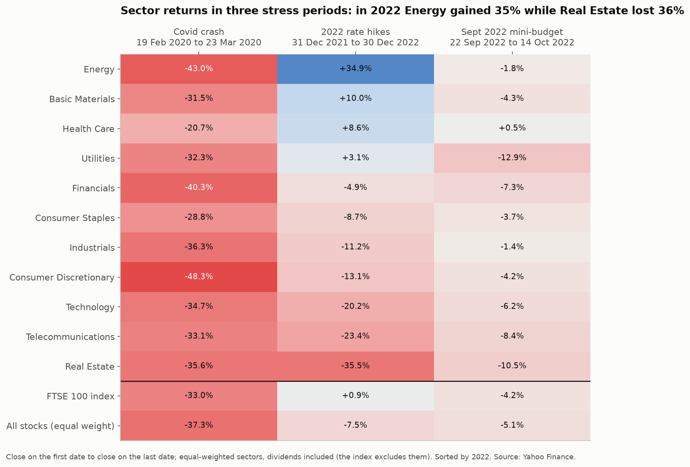

# FTSE 100 Risk & Rates Lab

**How risky are UK large-cap stocks and sectors, which sectors actually
diversify a portfolio, and how do stocks react to Bank of England interest
rate decisions?**

This project answers those questions with 17 years of daily data for today's
FTSE 100 companies and every Bank of England Bank Rate decision since 2010.
It describes what happened; it makes no price predictions.

## Project status

| Phase | Scope | Status |
|---|---|---|
| 1 | Data pipeline and data quality | ✅ Complete ([findings](docs/phase1_findings.md)) |
| 2 | Risk analytics: volatility, drawdown, beta, Sharpe, sector correlations, stress periods | ✅ Complete ([findings](docs/phase2_findings.md)) |
| 3 | Event study of Bank Rate decisions | Planned |
| 4 | Daily automated refresh and a Streamlit app | Planned |

## Headline findings so far

All figures cover January 2010 to November 2026 for today's FTSE 100 members.

**Risk (Phase 2)**
- **Basic Materials and Energy are the riskiest sectors;** Consumer Staples the
  steadiest (29% and 27% annualised volatility versus 15%).
- **Utilities, Health Care and Technology diversify best:** they move about
  three-quarters as much as the market (beta 0.68–0.75), with correlations of
  about 0.6 with the FTSE 100.
- **Diversification fails in a crash.** The average correlation between sectors
  rose from 0.49 to 0.71 in the Covid crash, and every sector fell 21–48%.
- **Rising rates split the market.** In 2022 Energy gained 35% while Real
  Estate lost 36%, even though the index ended flat. In the September 2022
  mini-budget, Utilities (−13%) and Real Estate (−10%) fell hardest.



**Data (Phase 1)**
- **The data needed real cleaning.** Free Yahoo Finance data contained a
  missed share split, histories from before a company's London listing, bad
  price prints on Bank Rate decision days, and three stocks priced in US
  dollars or euros. Each was found by an automated check and fixed or flagged
  with a written reason.
- **The Bank of England mostly holds.** Of 164 decisions since January 2010,
  138 were holds, 17 hikes and 9 cuts (two of them emergency Covid cuts). The
  small number of cuts will limit what Phase 3 can say about them.
- **14 of today's 100 members listed after 2010**, so comparisons over the
  full period cover 86 stocks.

Event-study findings will be added after Phase 3.

## Data

| Dataset | Source | In the repo? |
|---|---|---|
| Daily prices since January 2010 for the 100 current constituents and the FTSE 100 index (`^FTSE`) | Yahoo Finance via `yfinance` | No: downloaded by the pipeline |
| Constituents with ICB sector, snapshot of 15 November 2026 | Wikipedia, checked against FTSE Russell's 2026 index reviews | Yes: [`data/reference/`](data/reference/) |
| Every MPC Bank Rate decision (date, old rate, new rate, hike/cut/hold) | Bank of England MPC voting history | Yes: [`data/reference/`](data/reference/) |
| Daily Bank Rate (the risk-free rate) | Bank of England database, series IUDBEDR | No: downloaded by the pipeline |
| GBP/USD and GBP/EUR exchange rates | Yahoo Finance | No: downloaded by the pipeline |

Full source details and retrieval dates: [`data/reference/SOURCES.md`](data/reference/SOURCES.md).
Table and column definitions: [`docs/data_dictionary.md`](docs/data_dictionary.md).

## Method

### Phase 1: data pipeline

1. **Download** prices, exchange rates and Bank of England data.
2. **Raw layer:** load everything unchanged into a SQLite database.
3. **Clean layer** (readable SQL in [`sql/clean/`](sql/clean/)):
   align to London trading days, remove duplicates, apply documented
   corrections, convert non-sterling lines to pence, flag suspicious prices.
4. **Data quality checks:** 33 checks (27 must pass, 6 report items for
   review), run by the pipeline and by `pytest`. Results:
   [`outputs/data_quality_report.csv`](outputs/data_quality_report.csv).

### Data cleaning decisions

- Returns will use the **adjusted close** (includes dividends and splits).
- **Missing days are left missing**, never filled with the previous price,
  which would invent 0% returns and understate risk.
- A price is **removed only for a clear reason** (a bad print, a known data
  error, or history before a listing); every removed row is logged with its
  reason. Large genuine moves, such as the March 2020 crash, are kept.
- Stocks quoted in **US dollars or euros are converted to pence** so all
  returns are from a sterling investor's view.

### Phase 2: risk analytics

- **Returns:** simple daily returns from the adjusted close; a return needs
  prices on two consecutive trading days.
- **Volatility** = daily standard deviation × √252. **Annual return** =
  compound growth rate. **Maximum drawdown** = largest fall from a peak, with
  peak, trough and recovery dates.
- **Beta** against the FTSE 100 index from daily returns. **Sharpe ratio**
  uses the Bank Rate in force each day as the risk-free rate, so the
  0.1%–5.25% range of rates is reflected correctly.
- **Sectors** are equal-weighted portfolios of each ICB industry's members,
  rebalanced daily.
- **Correlations:** full-period sector correlation matrix, and one-year
  (252-day) rolling correlation of each sector with the index.
- **Stress periods:** Covid crash, 2022 rate hikes and the September 2022
  mini-budget, with dates and reasons in `src/ftselab/config.py`.
- **Robustness:** results recalculated without the days flagged in Phase 1, and
  with sectors built only from stocks that have the full history.

Results tables: [`outputs/tables/`](outputs/tables/).

Each decision, and why, is in [`docs/decisions.md`](docs/decisions.md).

## Limitations

- **Survivorship bias:** only companies in the FTSE 100 today are included.
  Companies that left the index or failed since 2010 are missing, so
  historical risk will look lower than it really was for an index investor.
- **Look-ahead bias:** today's sector labels are applied to the whole period.
- **Benchmark excludes dividends:** `^FTSE` is a price index, while stock
  returns include dividends.
- **Equal-weighted sectors:** unlike the index, sectors give every member the
  same weight; Energy and Telecoms have only three members each.
- **Unofficial price data:** Yahoo Finance is free but not audited.
- **No predictions:** this project describes past risk and past reactions; it
  does not forecast prices.

## How to run it

Requires Python 3 (built with 3.15) and an internet connection.

```bash
git clone https://github.com/CodeColonizer/ftse100-risk-rates-lab
cd ftse100-risk-rates-lab
python -m venv .venv
```

Activate the environment (Windows: `.venv\Scripts\activate`;
macOS/Linux: `source .venv/bin/activate`), then:

```bash
pip install -r requirements.txt
python run_pipeline.py
pytest
```

`run_pipeline.py` downloads all data (about a minute), builds
`data/ftse_lab.db`, runs the quality checks, calculates the risk analytics,
and saves charts to `outputs/figures/` and tables to `outputs/tables/`. If a
required data quality check fails, it stops before the analytics and exits
with an error.

Options:
- `python run_pipeline.py --offline` rebuilds from the cached downloads in `data/raw/`.
- `python run_pipeline.py --refresh-constituents` takes a new dated constituents snapshot first.

## Repository layout

```
run_pipeline.py        one command to run everything
src/ftselab/           download, database, quality check, risk and chart code
sql/clean/             clean-layer SQL
data/reference/        small committed reference files and their sources
tests/                 unit tests (synthetic data), data quality and output tests
docs/                  findings per phase, decision log, data dictionary
outputs/               quality report, results tables and charts
```
