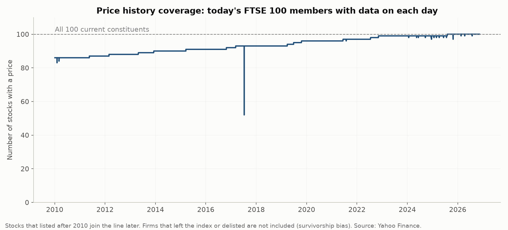
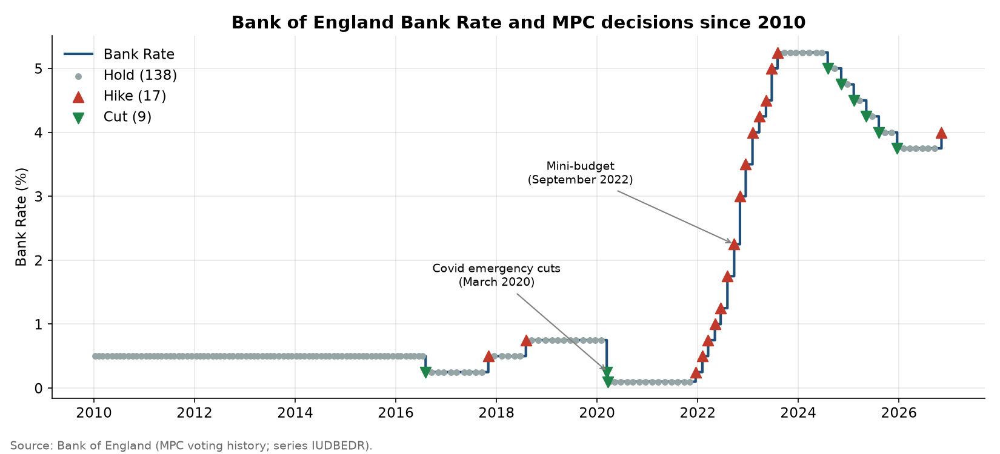

# Phase 1 findings: data pipeline and quality

**Status:** complete, 15 November 2026. Data runs from 4 January 2010 to
13 November 2026 (the last trading day before the build).

## What was built

One command (`python run_pipeline.py`) downloads the data, loads it unchanged
into a raw layer, builds a clean layer with SQL, runs 40 data quality checks (33 at the end of Phase 1; seven dividend checks were added in Phase 3) and
draws two charts. It takes under a minute with downloads, or under ten
seconds with `--offline`.

| Dataset | Rows | Coverage |
|---|---|---|
| Clean daily prices | 402,228 | 100 stocks + FTSE 100 index, 4,260 trading days |
| Constituents | 100 | 11 ICB industries |
| MPC Bank Rate decisions | 164 | Jan 2010 – Nov 2026 |
| Daily Bank Rate | 4,260 | every trading day |

## Key points for later phases

1. **86 of today's 100 members have prices for the whole period.** The other
   14 listed later, e.g. Glencore (2011), Haleon (2022), Metlen (2025). The
   chart below shows coverage rising from 86 to 100. Sector and stock
   comparisons in Phase 2 must use matching time windows or say clearly
   when they don't.

   

2. **The MPC mostly holds.** Of 164 decisions since 2010, 138 were holds (84%),
   17 hikes and 9 cuts, two of them the unscheduled Covid cuts of March 2020.
   With only 9 cuts, Phase 3 conclusions about cuts will be weak; holds give
   the largest sample but carry the least news, unless a move was expected.

   

3. **Bank Rate as the risk-free rate varies a lot:** 0.1% to 5.25%. Sharpe
   ratios before and after 2022 will not be comparable without this adjustment,
   which is why Phase 2 uses the daily rate rather than one average.

## Data problems found and how they were handled

The checks found real problems in the free Yahoo data. None was ignored.

| Problem | Example | Action |
|---|---|---|
| Split not applied to old prices | Polar Capital Technology: price "falls" 89.7% on 2 Jan 2013 | Earlier prices divided by 10 (documented correction) |
| Unusable history before listing | Lion Finance: price "jumps" 55x on 28 Feb 2012; Endeavour Mining: 619 of 851 days with zero volume before June 2021 | History before the listing date removed (documented) |
| Bad prints | Admiral, Informa and Melrose on 4 Feb 2010; Lloyds and Melrose on 5 Mar 2010: open = high = low = close, +17% to +34%, reversed next day | 5 rows removed by the flat-bar rule |
| Prices in US dollars or euros | Compass and IHG (whole history in USD), Metlen (EUR) | Converted to pence at the daily exchange rate |
| Carried-forward prices (found in Phase 2) | 11 July 2017: 41 stocks show zero volume and yesterday's close while the index moved −0.5% | 41 rows removed; treated as missing |
| Adjusted close ignores most dividends (found in Phase 3) | HSBC's adjusted and raw close differ by under 1% over 16 years despite several percent a year in dividends | Total returns rebuilt from Yahoo's dividend records (decision 25) |
| Dividends out of scale (found in Phase 3) | Melrose dividends before its Jan 2016 share consolidation were 15–22% of the price per payment | Scaled by 7/48, Yahoo's own consolidation ratio (documented correction) |
| Missing days | 26 stock-days in the source data (67 including the carried-forward rows), no stock missing more than 5 | Left missing, not filled |
| Minor inconsistency | Standard Life, 17 May 2010: daily low is 0.03p above the high | Kept; warning only |

All 1,178 removed rows are listed with reasons in the `clean_price_exclusions`
table. Every raw row on a trading day is accounted for (kept or logged), and a
test checks this.

**Note for Phase 3:** three of the bad prints fell on 4 February 2010, an MPC
decision day, and two on 5 March 2010, the day after one. Had they not been
removed, they would have created false "reactions" to those decisions. This shows why the cleaning matters for the
event study.

## Items flagged for review, not changed

24 one-day moves over 25% were kept. Most are clearly genuine (the Covid crash
in March 2020; 9 November 2020, when vaccine news lifted Rolls-Royce 44% and
IAG 26%; Glencore in September 2015). Two are probably caused by how Yahoo
handled a share consolidation with a special dividend, but could not be
checked against a second source, so they are kept and flagged:

- InterContinental Hotels, 9 May 2016: −30%, then +22% the next day.
- Melrose, 6 July 2016: +46% on high volume.

Phase 2 will check that the main results do not change when flagged days are
excluded.

## Limitations

- **Survivorship bias:** only today's members are included (see
  `docs/decisions.md`, decision 1).
- **Look-ahead bias:** today's sector labels are applied to the whole period.
- **Price index benchmark:** `^FTSE` excludes dividends; stock returns include them.
- **Unofficial data:** Yahoo Finance is free but not audited; the checks reduce
  the risk but cannot remove it.
- **Snapshot date:** the constituents reflect the September 2026 review; the
  December 2026 review is not included.
