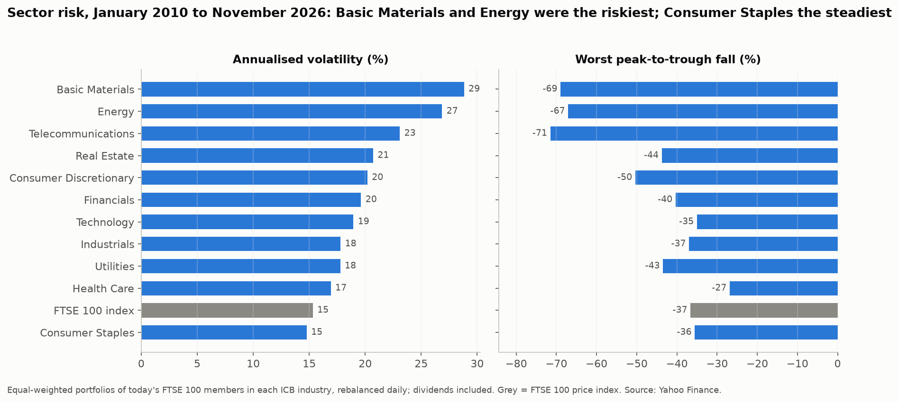
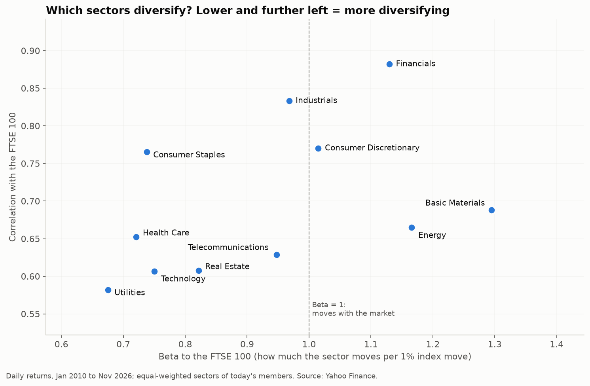
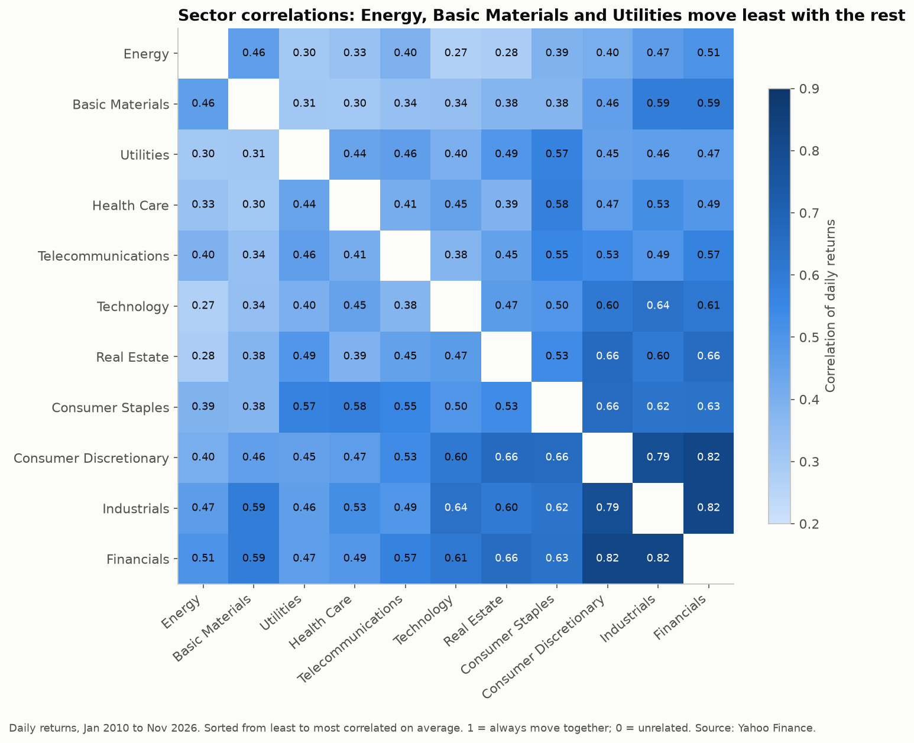
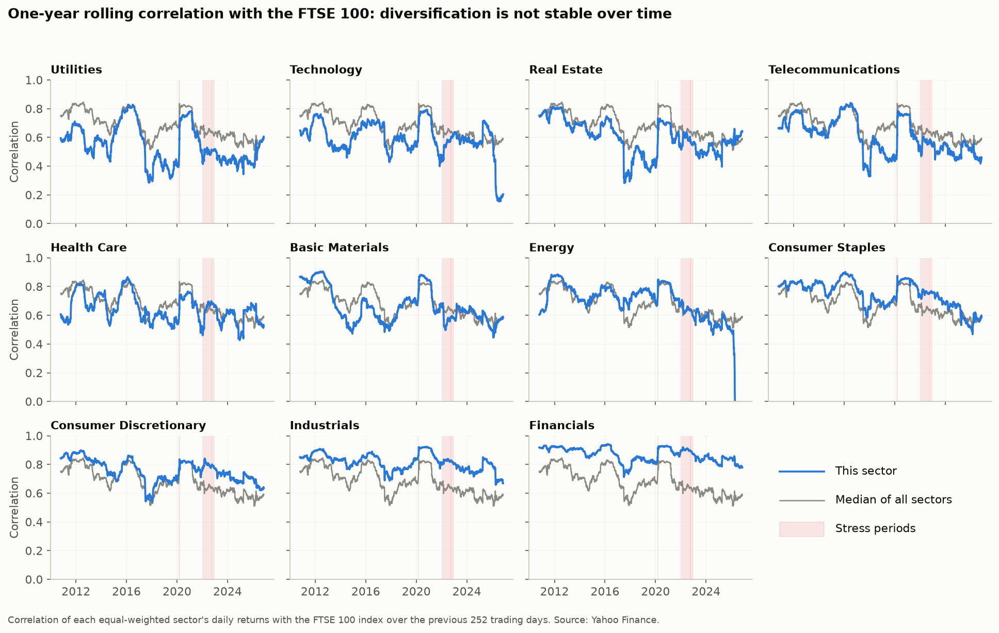
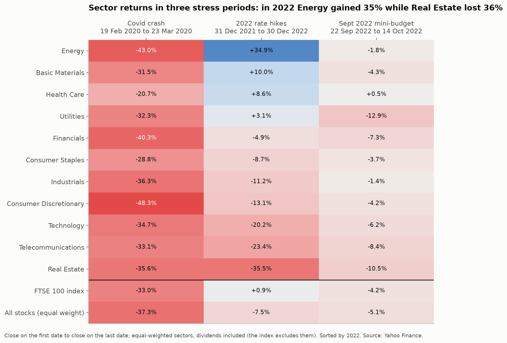

# Phase 2 findings: risk analytics

**Status:** complete, 15 November 2026. Daily data from 4 January 2010 to
13 November 2026 (16.9 years). All figures are for **today's** FTSE 100
members (see *Limitations*), using returns that include dividends.

## Summary for a business reader

1. **Basic Materials and Energy carry the most risk; Consumer Staples the
   least.** Mining and energy sectors swung about twice as much as staples
   (29% and 27% annualised volatility versus 15%) and lost about two-thirds of
   their value at their worst.
2. **The sectors that diversify best are Utilities, Health Care and
   Technology.** They have the lowest beta (0.68–0.75: they move about
   three-quarters as much as the market) and the lowest correlation with the
   FTSE 100 (about 0.6).
3. **Energy and Basic Materials are the least correlated with other sectors,
   but they do not reduce risk.** They move to their own rhythm (commodity
   prices) but swing hard, with betas above 1.1. They diversify in
   the sense of "behaves differently", not "is safer".
4. **Diversification weakens when it is needed most.** The average correlation
   between sectors rose from 0.49 over the full period to 0.71 during the Covid
   crash, when every sector fell between 21% and 48%.
5. **Rising rates split the market.** In 2022, when Bank Rate went from 0.25%
   to 3.5%, Energy gained 35% while Real Estate lost 36%. During the September
   2022 mini-budget, the rate-sensitive sectors fell most: Utilities −13% and
   Real Estate −10%, against −4% for the index.
6. **Relationships change over time.** In 2026 Energy's one-year correlation
   with the index fell below zero (−0.14 by November), so a historical average
   is a guide, not a constant.

## Sector risk

| Sector | Stocks | Volatility | Worst fall | Beta | Corr. with index | Sharpe |
|---|---|---|---|---|---|---|
| Consumer Staples | 11 | 14.8% | −36% | 0.74 | 0.77 | 0.36 |
| Health Care | 5 | 16.9% | −27% | 0.72 | 0.65 | 0.36 |
| Industrials | 16 | 17.8% | −37% | 0.97 | 0.83 | 0.71 |
| Utilities | 6 | 17.8% | −44% | 0.68 | 0.58 | 0.28 |
| Technology | 4 | 18.9% | −35% | 0.75 | 0.61 | 0.72 |
| Financials | 25 | 19.6% | −40% | 1.13 | 0.88 | 0.54 |
| Consumer Discretionary | 15 | 20.2% | −50% | 1.02 | 0.77 | 0.63 |
| Real Estate | 5 | 20.7% | −44% | 0.82 | 0.61 | 0.19 |
| Telecommunications | 3 | 23.1% | −71% | 0.95 | 0.63 | 0.28 |
| Energy | 3 | 26.9% | −67% | 1.17 | 0.66 | 0.16 |
| Basic Materials | 7 | 28.8% | −69% | 1.30 | 0.69 | 0.38 |
| *FTSE 100 index (price)* | | *15.3%* | *−37%* | *1.00* | *1.00* | *0.25* |

Full table with dates: [`outputs/tables/sector_risk.csv`](../outputs/tables/sector_risk.csv).

How to read it:
- **Volatility** is how much returns swing in a typical year. **Worst fall**
  (maximum drawdown) is the largest drop from a peak to a later low.
- **Beta** of 1.3 means the sector has typically moved 1.3% for each 1% move
  in the FTSE 100.
- **Sharpe** is return above Bank Rate per unit of volatility. Higher is better.
- Real Estate has still not recovered its peak of December 2021; its low
  came in October 2022, right after the mini-budget.
- Sector volatility is lower than for individual stocks (median stock: 28%),
  because company-specific swings partly cancel out inside a sector.

**On returns, with caution.** An equal-weighted mix of all 100 stocks returned
10.4% a year against 4.1% for the FTSE 100 price index. Most of that gap is not
skill or a strategy: the index excludes dividends (about 3–4% a year), and our
universe contains only companies that survived to be in the index today
(survivorship bias). These return figures describe the past and are not a
forecast.

## Which sectors diversify?

A sector diversifies a FTSE 100 portfolio if it moves **less** than the
market (low beta) and **differently** from it (low correlation).

- **Utilities, Health Care and Technology** sit bottom-left: the best
  diversifiers over the period.
- **Consumer Staples** has a low beta (0.74) but tracks the market closely
  (0.77 correlation). It cushions falls more than it behaves differently.
- **Financials and Industrials** are, in effect, the market (correlation over
  0.8). Adding more of them adds little diversification.

The strongest pairs are Financials with Consumer Discretionary and Industrials
(0.82 each). The weakest are Energy with Technology (0.27) and Energy with
Real Estate (0.28).

### Rolling correlations

- Correlations jump during market-wide shocks (2020 is visible in almost every
  panel), then fade.
- Utilities and Real Estate were least tied to the market in 2017–2019.
- **Energy decoupled in 2026,** falling to −0.14 by November: energy shares
  moved against the wider market for most of the year. There is no single
  outlier day behind this; it is a gradual change.
- **Technology fell to about 0.2 in 2026,** driven by large company-specific
  moves (e.g. RELX −14% on 3 February 2026) rather than market moves.

## Stress periods

| Period | Window (close to close) | Why these dates |
|---|---|---|
| Covid crash | 19 Feb 2020 → 23 Mar 2020 | Last close before the global sell-off accelerated, to the FTSE 100's lowest close of 2020 |
| 2022 rate hikes | 31 Dec 2021 → 30 Dec 2022 | Calendar 2022: 8 Bank Rate rises, 0.25% → 3.5% |
| Sept 2022 mini-budget | 22 Sep 2022 → 14 Oct 2022 | Close before the fiscal statement, to the day the Chancellor was replaced and the Bank's emergency gilt buying ended |

**Covid crash (index −33%).** No sector escaped. Health Care fell least
(−21%), Consumer Discretionary most (−48%); airlines were worst among stocks
(IAG −69%, easyJet −65%). Average sector correlation rose to 0.71, so
spreading money across sectors helped little.

**2022 rate hikes (index +0.9%).** The flat index hid a large rotation. Energy
(+35%), Basic Materials (+10%) and Health Care (+9%) rose; Real Estate (−36%),
Telecoms (−23%) and Technology (−20%) fell. This fits the usual explanation:
companies valued on distant future profits or on property values are hit
hardest when rates rise. The equal-weighted portfolio fell 7.5% while the
index rose, because the index is dominated by its largest companies, several
of which rose strongly (Shell +44%, BP +44%, AstraZeneca +29%, HSBC +15%).

**Mini-budget (index −4%).** A UK-specific shock to gilt yields. Utilities
(−13%) and Real Estate (−10%) fell most, as did UK consumer names (Next −18%,
JD Sports −16%, Barratt Redrow −16%). Health Care was flat. This is the
clearest case in the data of **interest rate risk inside equities**, which
Phase 3 will test properly around Bank Rate decisions.

Full results by stock: [`outputs/tables/stress_periods.csv`](../outputs/tables/stress_periods.csv).

## Robustness checks

| Test | What changed | Effect |
|---|---|---|
| Exclude the 24 flagged extreme-move days (Phase 1) | Stock volatility and beta for the 20 stocks with flagged days | Average change 1.3 points of volatility and 0.02 of beta; largest M&G (volatility 36% → 33%, beta 1.28 → 1.21) |
| Sectors built only from the 86 stocks with full history | Removes late joiners such as Haleon and Ithaca | Sector volatility changes by at most 0.8 points; beta by at most 0.06. Only near-ties swap places (Industrials and Utilities on volatility; Health Care, Consumer Staples and Technology on beta) |

The conclusions above hold under both tests, and the two 2016 rows flagged in
Phase 1 (IHG, Melrose) do not drive any finding. Details: [`outputs/tables/robustness.csv`](../outputs/tables/robustness.csv).

## Limitations

- **Survivorship bias:** only companies in the index today are included, so
  risk is understated and returns overstated compared with holding the actual
  index over time.
- **Look-ahead bias:** today's sector labels are applied back to 2010.
- **Equal weighting:** sectors are equal-weighted portfolios of their members,
  not market-cap weighted like the index, so small members count as much as
  giants. Shares-in-issue data was not available for free.
- **Small sectors:** Telecoms and Energy have three members each and Technology
  four, so one company can drive the sector figure.
- **Price-index benchmark:** `^FTSE` excludes dividends. This barely affects
  volatility, beta and correlation, but understates the index's return and
  Sharpe ratio.
- **Daily data:** correlations use daily closes. Stocks with overseas listings
  and different trading hours can show slightly lower daily correlations than
  weekly data would.
- **Past, not future:** none of these figures is a prediction.
