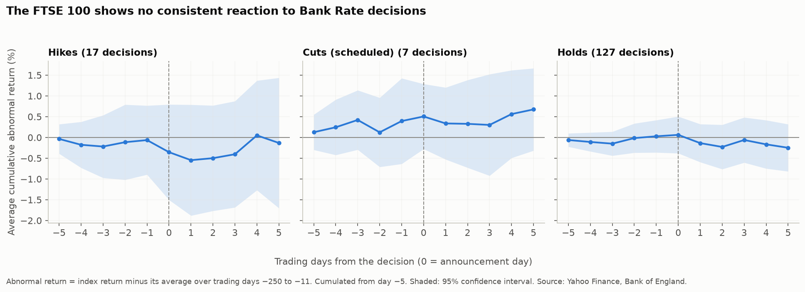
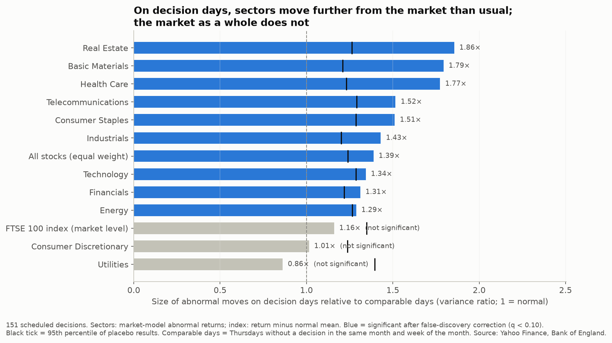
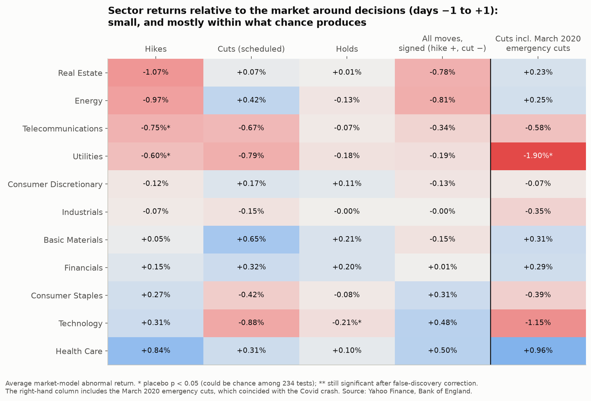
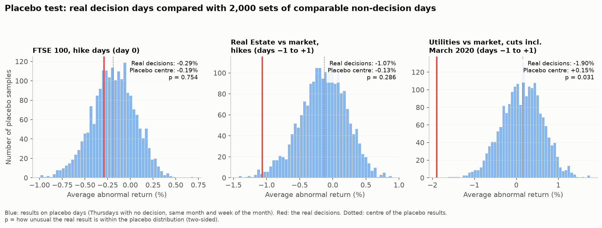

# Phase 3 findings: how do UK large caps react to Bank Rate decisions?

**Status:** complete, 15 November 2026. 153 Monetary Policy Committee (MPC)
decisions from December 2010 to November 2026: 17 hikes, 7 scheduled cuts,
2 emergency cuts (March 2020) and 127 holds. The 11 decisions before December
2010 are left out because there is not yet a year of history to define
"normal" behaviour.

## Summary for a business reader

1. **The FTSE 100 as a whole shows no reliable reaction to Bank Rate
   decisions.** On average, hikes, cuts and holds all leave the index within
   what happens on comparable days without a decision, and the index does not
   move more than usual on decision days.
2. **Sectors, however, do move more than usual relative to the market.** On
   decision days, 9 of the 11 sectors moved further away from the market than
   on comparable days, by about 1.3 to 1.9 times the normal variance. The news
   shows up as *rotation between sectors*, not as a move in the whole market.
3. **Knowing whether the Bank hiked, cut or held does not tell you which way a
   sector will go.** No sector's average reaction to hikes, cuts or holds
   survives a correction for the number of tests run. Real Estate fell 1.1%
   relative to the market around hikes, as one would expect, but its
   decision-day moves are so variable that this is not distinguishable from
   chance.
4. **The likely reason is that markets anticipate most decisions.** What moves
   prices is the *surprise* and the Bank's guidance, not the decision itself,
   and a free, clean measure of the surprise was not available (see
   *Limitations*).

These are statements about the past 16 years for today's FTSE 100 members.
They are not a forecast or a trading rule.

## Method in brief

- **Abnormal return** = actual return minus a "normal" return estimated from
  trading days −250 to −11 before each decision, leaving out the days around
  every other decision.
  - *Market level:* FTSE 100 return minus its own normal average (constant-mean
    model).
  - *Sector and stock level:* return minus what the FTSE 100's move that day
    predicts (market model). This measures moves **relative to the market**.
- **Windows:** the announcement day (day 0; decisions are announced at noon,
  so the close reflects them), days −1 to +1, and days 0 to +5.
- **Groups:** hikes, scheduled cuts, cuts including the March 2020 emergency
  cuts, holds, all scheduled decisions, and all moves "signed" (a hike counts
  +, a cut −) to pool hikes and cuts.
- **Placebo test (main test).** Each result is compared with 2,000 sets of
  *comparable days*: Thursdays without a decision, in the same calendar month
  and week of the month as the real decisions. This controls for Thursday
  effects (most UK ex-dividend dates are Thursdays) and for the company results
  season. The test is studentised, so it is not fooled by decision days simply
  being more volatile.
- **Multiple testing.** 234 market and sector tests were run; a
  Benjamini–Hochberg correction (10% false discovery rate) decides what counts
  as a finding.

Full reasoning for each choice: decisions 25–34 in
[`decisions.md`](decisions.md).

## 1. The market as a whole

| Decisions | Number | FTSE 100 on day 0 | Comparable days | Placebo p |
|---|---|---|---|---|
| Hikes | 17 | −0.29% | −0.19% | 0.75 |
| Cuts (scheduled) | 7 | +0.11% | −0.17% | 0.46 |
| Holds | 127 | +0.03% | −0.09% | 0.11 |

None of the 18 market-level tests (6 groups × 3 windows) is significant, even
before correcting for multiple tests. Wide confidence bands for hikes and cuts
show how few decisions there are: 17 hikes and 7 scheduled cuts in 16 years.

Note that comparable Thursdays are not centred on zero. The FTSE 100 is a
price index, and 73% of dividend ex-dates fall on Thursdays, so the index
averages −5.4 basis points on Thursdays against +0.4 to +8.0 on other weekdays.
This is why results are compared with comparable days rather than with zero.

## 2. Sectors move more than usual on decision days

| Series | Size of moves vs comparable days (variance ratio) | Significant? |
|---|---|---|
| Real Estate | 1.86× | yes |
| Basic Materials | 1.79× | yes |
| Health Care | 1.77× | yes |
| Telecommunications | 1.52× | yes |
| Consumer Staples | 1.51× | yes |
| Industrials | 1.43× | yes |
| Technology | 1.34× | yes |
| Financials | 1.31× | yes |
| Energy | 1.29× | yes |
| Consumer Discretionary | 1.01× | no |
| Utilities | 0.86× | no |
| *FTSE 100 index (market level)* | *1.16×* | *no* |

Significant = false-discovery-adjusted q < 0.10 (all the "yes" rows are below
0.05). Full table: [`outputs/tables/event_volatility.csv`](../outputs/tables/event_volatility.csv).

Two patterns sit behind these ratios:
- For **Consumer Staples, Financials, Industrials and Technology**, the
  *typical* decision day is livelier: the median size of the move is 17–25%
  larger than on comparable days.
- For **Real Estate, Basic Materials, Health Care and Telecoms**, a handful of
  very large decision days drive the ratio. Some are plausibly about rates:
  Real Estate +6.3% relative to the market on 2 February 2023, when the Bank
  hiked but signalled rates were near their peak, and −4.4% on 22 September
  2022, the day before the mini-budget. Others more likely reflect news that
  happened to land on the same day, such as Basic Materials +10.3% on
  4 February 2016 during that year's commodity rebound.

So the evidence that decisions *move* sectors is strong. Some of it may still
be other news released on MPC Thursdays (results, data, commodity moves) that
the calendar matching does not fully remove.

## 3. No reliable direction by decision type

Average reaction relative to the market, days −1 to +1:

| Sector | Hikes (17) | Cuts (7) | Holds (127) |
|---|---|---|---|
| Real Estate | −1.07% | +0.07% | +0.01% |
| Energy | −0.97% | +0.42% | −0.13% |
| Telecommunications | −0.75% | −0.67% | −0.07% |
| Utilities | −0.60% | −0.79% | −0.18% |
| Health Care | +0.84% | +0.31% | +0.10% |
| Technology | +0.31% | −0.88% | −0.21% |

- Only 7 of the 234 market and sector tests (3.0%) have a placebo p-value
  below 0.05. That is no more than chance would produce, and none survives the
  false-discovery correction (smallest q = 0.99).
- The pattern is economically sensible: rate-sensitive Real Estate,
  Utilities and Telecoms lag the market around hikes, and defensive Health
  Care leads. But the samples are small and decision days are volatile, so
  these averages are within the range seen on comparable days.
- The emergency cuts of March 2020 show the largest averages (e.g. Utilities
  −1.9%), but they coincide with the Covid crash and cannot be attributed to
  the rate cuts.
- **Stocks:** 1,776 stock-level tests; 6.1% have p < 0.05 and none survives
  the correction (smallest q = 0.13). No individual stock can be called
  "rate-sensitive" on this evidence.

### Placebo test

The placebo test asks: *if we picked comparable non-decision days instead,
how often would we see a result this large?*
- The FTSE 100 on hike days is right in the middle of the placebo range
  (p = 0.75).
- Real Estate's −1.07% around hikes looks large, but once the extra
  volatility of decision days is allowed for, 29% of placebo samples are at
  least as unusual (studentised p = 0.29).
- Only the Covid-era emergency cuts sit in the tail, and they are confounded.

### Checking the tests themselves

- On placebo days, the ordinary t-test wrongly flags 7% (hike-sized samples)
  to 17% (hold-sized samples) of results as significant at the 5% level, more
  than the 5% it promises. This is because comparable days are not centred on
  zero. That is why the placebo test is the main test.
- A raw-average placebo test flagged 9.8% of market and sector tests, because
  decision days are more volatile. The studentised version flags 3.0%, in line
  with chance. A unit test confirms this behaviour on synthetic data.

## What this means

- For a FTSE 100 investor, **Bank Rate decision days are not a reason to
  expect the whole market to move one way**.
- They are days of **above-normal sector rotation**: the relative performance
  of property, miners, healthcare, telecoms and others shifts more than usual.
  A portfolio tilted towards one sector carries more decision-day risk than
  the index does.
- The rate story of Phase 2 (Real Estate and Utilities hit hardest in 2022 and
  in the mini-budget) shows up over months of changing rate expectations, not
  as a predictable jump on decision days.

## Limitations

- **No surprise measure.** The direction of a reaction depends on how far the
  decision and guidance differ from expectations. Market-implied expectations
  (overnight index swap rates) were not freely available as a clean daily
  series. This is the most useful next step.
- **Small samples.** 17 hikes and 7 scheduled cuts; with this few events, only
  large effects could be detected.
- **Same-day news.** Daily closes cannot separate the noon announcement from
  other news that day (company results, US data at 13:30, commodity moves).
  Many MPC days are also quarterly Monetary Policy Report days, with
  forecasts and a press conference.
- **Market model benchmark.** The FTSE 100 price index excludes dividends,
  and stock returns include them. The calendar-matched placebo absorbs the
  resulting Thursday effect, but it is an approximation.
- **Survivorship and look-ahead bias** as in earlier phases: today's members
  and today's sector labels.
- **Overlapping events in 2020.** The decisions of 11, 19 and 26 March 2020
  (two emergency cuts and a hold) fall within days of each other and of the
  Covid crash.
